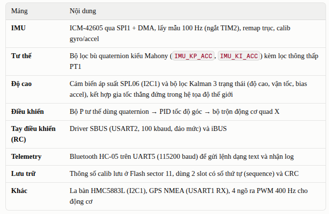

# BlueberryF405 Flight Controller

Firmware bare-metal cho quadcopter chạy trên mạch điều khiển bay **STM32F405**.
Định nghĩa thanh ghi nằm trong [include/register.h](include/register.h).

## Tính năng



## Phần cứng / sơ đồ chân

| Chức năng          | Ngoại vi   | Chân |
|--------------------|------------|------|
| IMU ICM-42605      | SPI1       | SCK PA5, MISO PB4, MOSI PA7, CS PC14 |
| Baro SPL06 (0x76), la bàn HMC5883L (0x1E) | I2C1 | SCL PB8, SDA PB7 |
| Bluetooth HC-05    | UART5      | TX PC12, RX PD2 |
| Bộ thu SBUS        | USART2     | RX PA3 |
| GPS                | USART1     | RX PA10 |
| Động cơ 1–4 (PWM)  | TIM8 CH4, TIM8 CH3, TIM1 CH3N, TIM1 CH1 | PC9, PC8, PB15, PA8 |
| LED (tích cực mức thấp) | GPIOA | Đỏ PA13, Xanh dương PA14 |

Xung nhịp: SYSCLK 168 MHz lấy từ HSI + PLL, APB1 = 42 MHz, APB2 = 84 MHz, SysTick 1 ms.

> PA13/PA14 cũng là chân SWD (SWDIO/SWCLK). Vì firmware dùng hai chân này cho LED, khi nạp lại có thể phải kết nối ở chế độ "connect under reset" (hoặc dùng DFU).

## Build

Cần cài:

- Toolchain `arm-none-eabi-gcc` (gcc, objcopy, size, gdb)
- `make`
- `openocd` kèm ST-Link, **hoặc** `dfu-util` để nạp qua USB DFU

```sh
make            # tạo blueberryf405.elf / .hex / .bin
make clean
```

File object nằm trong `build/`. Mức dùng bộ nhớ được in ra sau khi link.

## Nạp firmware & debug

```sh
make flash      # OpenOCD + ST-Link: nạp, kiểm tra (verify), reset
make dfu        # USB DFU (giữ nút BOOT khi cắm cáp)
make debug      # chạy OpenOCD và gắn arm-none-eabi-gdb vào cổng :3333
make dump       # disassembly xen kẽ với mã nguồn
make map        # tóm tắt các section từ file map của linker
```

## Trình tự khởi động

1. Cấu hình clock, SysTick, LED, sau đó khởi tạo ICM-42605.
   - **LED đỏ nháy 3 lần**: IMU OK.
   - **LED xanh nháy mãi**: khởi tạo IMU thất bại.
2. Khởi động HC-05 (UART5) và SBUS (USART2).
3. Firmware chờ khoảng 15 s, khởi tạo SPL06, chờ thêm khoảng 8 s, rồi lấy trung bình 50 mẫu áp suất làm mốc mặt đất (baseline).
4. Đọc thông số calib IMU từ Flash. Nếu chưa có thì dùng offset bằng 0 và in ra `No calib data, using defaults`.
5. Khởi tạo bộ lọc Kalman độ cao, chạy TIM7 ở 2 kHz (kích đọc IMU), rồi bắt đầu vòng lặp chính.

## Vòng lặp: nhanh 2 kHz trong ngắt, chậm trong main loop

**Vòng nhanh (2 kHz, trong ngắt DMA, `FlightControl_FastUpdate`):** TIM7 kích đọc IMU mỗi 0.5 ms (ICM-42605 chạy ODR 4 kHz). Đọc xong, ngắt DMA chạy cả chuỗi:

```
ICM42605 → remap trục → trừ calib → lọc PT1 (accel 20 Hz, gyro 100 Hz)
        → AHRS (quaternion) → cộng dồn gia tốc hệ trái đất
        → quaternion mục tiêu → điều khiển tư thế → rate PID (lọc D 80 Hz)
        → mixer → PWM
```

**Vòng chậm (main loop, `FlightControl_SlowUpdate`):**

| Nhịp | Công việc |
|---|---|
| ~100 Hz | Trung bình 20 mẫu gia tốc → predict Kalman độ cao và ước lượng vị trí (dT = thời gian thực) |
| 25 Hz | Baro → update Kalman; máy trạng thái; vòng độ cao → ga; vòng yaw |
| 25 Hz | Compass (lệch pha 20 ms với baro) |
| 10 Hz | Vòng vị trí XY → roll, pitch |
| khi có | GPS → update ước lượng vị trí |

Vì đọc I2C và in log Bluetooth chỉ nằm ở vòng chậm, chúng không làm lỡ nhịp 2 kHz. Gửi `LOGPERF` để xem thời gian xử lý vòng nhanh, chu kỳ thực và số lần lỡ đọc IMU.

**Ước lượng độ cao:**
- Khi DISARMED hoặc IDLE, Kalman neo h = 0, v = 0, học bias accel, và kéo dần áp suất gốc theo thời tiết.
- Baro bị loại liên tục khoảng 1 s thì reset theo baro.
- Quá 500 ms không có mẫu baro hợp lệ thì `AltitudeKF_IsHealthy()` = false. Khi đó đang bay sẽ chuyển sang **LAND_BLIND**: ga giảm dần về 0.30 trong 10 s, chỉ nhận cử chỉ DISARM; baro tốt lại thì về ALT_HOLD. Đang ở dưới đất thì không cho CLIMB.

## Lệnh Bluetooth (HC-05, 115200 baud)

Mỗi lệnh là một dòng text kết thúc bằng `\n`. Board trả lời cho từng lệnh.

| Lệnh         | Phản hồi          | Tác dụng |
|--------------|-------------------|----------|
| `PING`       | `PONG`            | Kiểm tra kết nối |
| `START` / `STOP` | `OK_START` / `OK_STOP` | Bật/tắt stream telemetry |
| `CALIB`      | `OK CALIB`        | Calib gyro rồi calib accel |
| `CALIBGYRO`  | `OK_CALIB_GYRO`   | Calib gyro. Giữ board **đứng yên**. Lưu vào Flash |
| `CALIBACCEL` | `OK_CALIB_ACCEL`  | Calib accel. Đặt board **nằm phẳng, đứng yên**. Lưu vào Flash |
| `CALIBERASE` | `OK_CALIB_ERASE`  | Xóa dữ liệu calib đã lưu |
| `ARM` / `DISARM` / `HOLD` / `CLIMB` / `LAND` | `OK_<LỆNH>` | Lệnh bay (đã parse, xem phần trạng thái bên dưới) |

Lệnh không hợp lệ sẽ nhận `ERR_CMD`. LED xanh sáng trong suốt quá trình calib.

> Comment trong `hc05.h` ghi `CALIB_GYRO`... có dấu gạch dưới. Nhưng bộ parse trong `hc05.c` thực tế nhận lệnh **không có** gạch dưới như bảng trên.

## Cấu trúc thư mục

```
include/            register.h (bản đồ thanh ghi MCU), types.h (Vec3_t ...)
src/main.c          khởi tạo, trình tự boot, vòng lặp chính, các hàm ngắt
src/drivers/        spi, I2C, uart5, usart1, timer, pwm_out, sbus, ibus, flash_storage
src/sensors/        icm42605, spl06, hmc5883l, gps, hc05
src/estimation/     quaternion, imu (bộ lọc tư thế), attitude, filter (PT1), altitude (KF)
src/control/        pid, attitude_control, rate_control, motor_mixer, flight_state, altitude_control
startup.s           bảng vector, reset handler (khởi tạo .data/.bss, bật FPU)
stm32_flash.ld      Flash 1 MB @ 0x08000000, RAM 128 KB, stack 4 KB ở đỉnh RAM
```

Khi thêm file nguồn mới, khai báo nó trong `C_SRCS` của [Makefile](Makefile). Nếu file nằm ở thư mục mới, thêm cả thư mục đó vào `C_INCLUDES`.

## Thông số tinh chỉnh

- Bộ lọc tư thế: `IMU_KP_ACC`, `IMU_KI_ACC` trong [src/estimation/imu.h](src/estimation/imu.h)
- Hệ số P tư thế: tham số truyền vào `AttitudeControl_Update(...)` trong [src/main.c](src/main.c) (hiện tại 5 / 5 / 3)
- Nhiễu của KF độ cao: `NOISE_ALT`, `NOISE_VEL`, `NOISE_BIAS`, `NOISE_BARO` trong [src/main.c](src/main.c)
- Bộ điều khiển độ cao: các hằng `ALT_*` trong [src/control/altitude_control.h](src/control/altitude_control.h)
- PWM động cơ: `MOTOR_PWM_HZ`, `MOTOR_MIN_US`, `MOTOR_MAX_US` trong [src/drivers/pwm_out.h](src/drivers/pwm_out.h)

## Trạng thái / đang phát triển

Firmware vẫn đang được phát triển và **chưa bay được**:

- Ngõ ra của bộ điều khiển tốc độ góc đã được tính, nhưng chưa đưa vào `MotorMixer` / `pwm_out`, nên động cơ chưa được điều khiển.
- Các kênh SBUS đã được đọc trong vòng lặp chính nhưng chưa dùng làm setpoint. Setpoint tư thế đang cố định ở trạng thái nằm ngang.
- `AltitudeKF_UpdateBaro` (bước hiệu chỉnh bằng baro) chưa được gọi trong vòng lặp chính. Hiện chỉ có bước dự đoán chạy.
- `altitude_control.c` đã có nhưng chưa được thêm vào `C_SRCS` trong Makefile.
- Các module GPS, la bàn và flight-state đã được biên dịch nhưng chưa được gọi từ `main`.

**An toàn:** luôn tháo cánh quạt mỗi khi thử ngõ ra động cơ.
