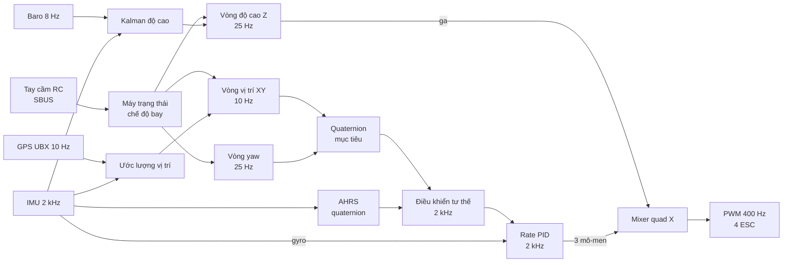
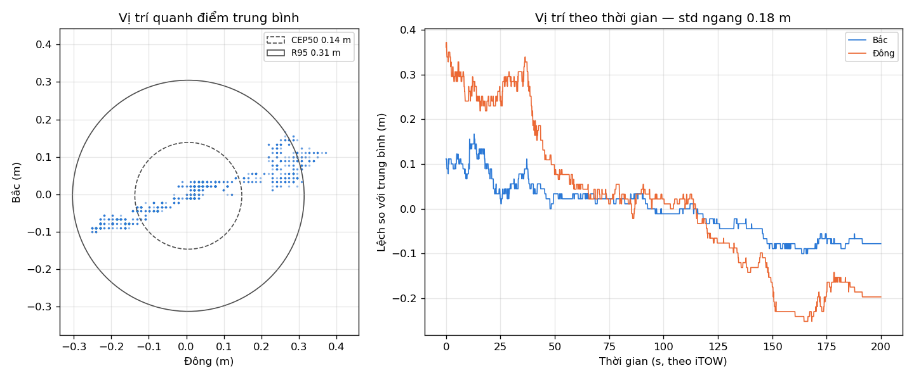
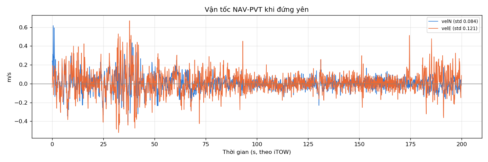

# BlueberryF405 Flight Controller

Firmware bay tự viết từ đầu cho quadcopter dùng mạch **STM32F405** (Cortex-M4F, 168 MHz).
Toàn bộ code làm việc trực tiếp với thanh ghi (không HAL, không CMSIS, không RTOS): driver ngoại vi, bộ ước lượng tư thế/độ cao/vị trí, các vòng điều khiển lồng nhau và máy trạng thái chế độ bay.

> **Trạng thái:** đã kiểm tra trên bàn (tháo cánh), **chưa bay thử**. Chi tiết ở mục [Trạng thái và hạn chế](#trạng-thái-và-hạn-chế).

## Điểm nổi bật

- **Vòng điều khiển nhanh 2 kHz chạy trong ngắt DMA:** đọc IMU, AHRS, điều khiển tư thế, rate PID, mixer, PWM. Việc đọc I2C, parse GPS và in log nằm ở vòng chậm trong main loop nên không làm lỡ nhịp.
- **Điều khiển nhiều vòng lồng nhau:** vòng độ cao 25 Hz, vòng vị trí XY 10 Hz, vòng yaw 25 Hz tạo quaternion mục tiêu, sau đó là vòng tư thế và rate PID.
- **Ước lượng:**
  - Tư thế bằng bộ lọc bù Mahony trên quaternion (gyro + accel, mag chỉ sửa yaw).
  - Độ cao bằng Kalman 3 trạng thái (độ cao, vận tốc, bias accel) kết hợp baro SPL06, có cổng loại mẫu bất thường (3σ), tự reset khi baro bị loại liên tục và neo về 0 khi ở dưới đất.
  - Vị trí/vận tốc ngang bằng bộ lọc bù GPS + gia tốc IMU.
- **GPS đọc giao thức UBX (NAV-PVT)** bằng máy trạng thái từng byte, có kiểm tra checksum và đồng bộ lại khi lỗi. Parser có test đơn vị chạy trên PC.
- **Máy trạng thái chế độ bay** điều khiển bằng tay cầm SBUS: bay lên, giữ độ cao, giữ vị trí, bay tới/sang trái 5 s, hạ cánh, cùng failsafe mất RC và mất baro (hạ cánh mù).
- **Lưu calib vào Flash** dạng ghi nối tiếp (512 slot, CRC32, đọc lại kiểm tra sau khi ghi), không ghi đè lên vùng chưa xoá.
- **Công cụ kiểm thử trên bàn qua Bluetooth:** motor test từng chân, chế độ BENCH, đo tải vòng nhanh, log GPS ra CSV.

## Phần cứng

| Chức năng | Ngoại vi | Chân |
|---|---|---|
| IMU ICM-42605 | SPI1 + DMA | SCK PA5, MISO PB4, MOSI PA7, CS PC14 |
| Baro SPL06 (0x76), la bàn HMC5883L (0x1E) hoặc QMC5883L (0x0D), tự nhận | I2C1 | SCL PB8, SDA PB7 |
| Bluetooth HC-05 | UART5, 115200 | TX PC12, RX PD2 |
| Bộ thu SBUS | USART2, 100 kbaud 8E2 | RX PA3 |
| GPS u-blox | USART1, 115200 | RX PA10 |
| Động cơ M1 / M2 | TIM1 CH3N / CH1 | PB15 / PA8 |
| Động cơ M3 / M4 | TIM2 CH4 / CH3 | PB11 / PB10 |
| LED (tích cực mức thấp) | GPIOA | Đỏ PA13, xanh dương PA14 |

Xung nhịp: SYSCLK 168 MHz (HSI 16 MHz, PLL M=16, N=336, P=2), APB1 42 MHz, APB2 84 MHz. TIM7 kích đọc IMU ở 2 kHz, TIM5 đếm 5 s cho các chế độ di chuyển, SysTick 1 ms.

Bố trí động cơ (nhìn từ trên xuống, quad X):

```
       M4 CW (S6)      M1 CCW (S3)
              \   ^   /
               \  |  /
                [ FC ]
               /      \
              /        \
       M3 CCW (S5)     M2 CW (S4)
```

> PA13/PA14 cũng là chân SWD. Vì firmware dùng hai chân này cho LED, có thể phải nạp ở chế độ "connect under reset" hoặc dùng DFU.

## Kiến trúc điều khiển



| Vòng | Nhịp | Nơi chạy |
|---|---|---|
| IMU, AHRS, điều khiển tư thế, rate PID, mixer, PWM | 2 kHz | Ngắt DMA đọc IMU |
| Predict Kalman độ cao và ước lượng vị trí | khoảng 100 Hz (trung bình 20 mẫu gia tốc) | Main loop |
| Baro, máy trạng thái, vòng độ cao, vòng yaw, compass | 25 Hz | Main loop |
| Vòng vị trí XY | 10 Hz | Main loop |
| Update ước lượng vị trí | khi có gói GPS mới | Main loop |

Quy ước hệ trục thân drone: X hướng trước, Y hướng trái, Z hướng lên (FLU), roll dương là nghiêng phải, pitch dương là chúc mũi, yaw dương là quay trái. Hệ trái đất: X hướng Bắc, Y hướng Tây, Z hướng lên.

## Chế độ bay

Chọn bằng bốn kênh đầu của tay cầm SBUS (CH1 roll, CH2 pitch, CH3 ga, CH4 yaw). Mức cần: thấp dưới 1200 µs, giữa 1300–1700 µs, cao trên 1800 µs.

| Chế độ | Cách vào | Hành vi |
|---|---|---|
| ARM | Ga thấp + yaw phải, giữ 1 s | Từ DISARMED sang IDLE, động cơ đứng yên |
| DISARM | Ga thấp + yaw trái, giữ 0.5 s | Tắt động cơ |
| CLIMB | Ga cao | Tăng độ cao mục tiêu 1 m, xong về chế độ hold trước đó |
| ALT_HOLD | Ga giữa + kéo pitch về, giữ 0.5 s | Giữ độ cao bằng baro + IMU, không cần GPS |
| POS_HOLD | Ga giữa + roll phải, giữ 0.5 s | Giữ độ cao và vị trí, cần GPS và compass |
| FORWARD / LEFT | Ga giữa + pitch tới / roll trái, giữ 0.5 s | Bay 1 m/s theo hướng mũi trong 5 s (TIM5) rồi về POS_HOLD, độ cao không đổi |
| LAND | Ga thấp | Hạ tối đa 0.5 m/s, chạm đất về IDLE |
| LAND_BLIND | Tự động khi mất ước lượng độ cao lúc đang bay | Ga giảm dần về 0.30 trong 10 s, chỉ nhận cử chỉ DISARM |

Mất tín hiệu SBUS hoặc receiver báo failsafe thì DISARM ngay. POS_HOLD, FORWARD, LEFT bị từ chối nếu thiếu GPS hoặc compass, và mất GPS giữa chừng thì tự về ALT_HOLD.

## Build và nạp

Cần `arm-none-eabi-gcc`, `make`, và `openocd` (ST-Link) hoặc `dfu-util` (USB DFU).

```sh
make            # tạo blueberryf405.elf / .hex / .bin
make flash      # OpenOCD + ST-Link
make dfu        # USB DFU (giữ nút BOOT khi cắm cáp)
make debug      # OpenOCD + arm-none-eabi-gdb
make dump       # disassembly xen kẽ mã nguồn
make clean
```

Nạp qua DFU thì **rút GPS ra trước**: bootloader ROM của STM32 cũng nghe USART1, dữ liệu từ GPS làm nó bỏ chế độ USB DFU.

## Lệnh Bluetooth (HC-05, 115200 baud)

Mỗi lệnh là một dòng text kết thúc bằng `\n`. Firmware khởi động mất khoảng 30 s (chờ cảm biến ổn định, lấy mốc áp suất) và chưa trả lời lệnh trong thời gian đó.

| Nhóm | Lệnh | Tác dụng |
|---|---|---|
| Chung | `PING` | Trả về `PONG` |
| | `START` / `STOP` | Bật/tắt stream log |
| Calib (chỉ khi DISARMED) | `CALIB`, `CALIBGYRO`, `CALIBACCEL` | Calib gyro/accel, lưu vào Flash. Để drone nằm yên |
| | `CALIBSHOW`, `CALIBERASE` | Xem / xoá calib đã lưu |
| Thử trên bàn (**tháo cánh**) | `M1`…`M4`, `MALL`, `MSTOP` | Quay từng động cơ ở 1200 µs trong 3 s |
| | `BENCH`, `BENCHOFF` | ARM qua Bluetooth, ga cố định 35%, vòng tư thế và rate chạy thật, in giá trị µs của 4 động cơ. Tự tắt sau 120 s |
| Log | `LOGNORM`, `LOGPERF`, `LOGMAG`, `LOGGPS` | Đổi kiểu log. `LOGPERF` in thời gian xử lý vòng nhanh và số lần lỡ đọc IMU |
| | `GPSCSV` | Log GPS thô dạng CSV cho `tools/gps_logger.py` |
| Compass | `MAGCAL`, `MAGCALEND` | Calib hard-iron bằng cách xoay drone mọi hướng |

`ARM`, `HOLD`, `CLIMB`, `LAND` được parse nhưng chưa dùng, vì chế độ bay lấy từ SBUS. `DISARM` dùng để tắt chế độ BENCH.

## Công cụ và kiểm thử

```sh
python3 tools/gps_logger.py            # ghi 2000 mẫu GPS hợp lệ qua /dev/rfcomm0 vào tools/LOG
python3 tools/analyze_gps.py           # phân tích file mới nhất: std, CEP50, R95, trôi, nhiễu vận tốc
make -C tools/ubx_test test            # test đơn vị parser UBX trên PC (gcc)
```

Parser UBX trên PC được biên dịch từ chính `src/sensors/gps.c`, kiểm tra các trường hợp: gói tốt, sai checksum, gói bị cắt giữa chừng, gói lạ dài 300 byte, `fixType` 5 (chỉ có thời gian), và NAV-PVT sai độ dài.

### Kết quả đo GPS khi đứng yên

Một lần đo ngoài trời, 2000 mẫu hợp lệ (fix 3D, từ 6 vệ tinh, hAcc không quá 3 m), module u-blox 10 Hz:

| Chỉ số | Giá trị |
|---|---|
| Tần số thực | 10.00 Hz, không hụt mẫu |
| Độ lệch chuẩn ngang | 0.181 m |
| CEP50 / R95 | 0.142 m / 0.309 m |
| Nhảy giữa hai mẫu lớn hơn 2 m | 0 lần |
| Trôi chậm | 0.18 m/phút |
| Nhiễu vận tốc khi đứng yên (N / E) | ±0.084 / ±0.121 m/s |
| hAcc chip tự báo | trung bình 0.92 m |




Đây là một lần đo ở một vị trí, kéo dài khoảng 200 s. Dữ liệu thô nằm ở [docs/gps_test/](docs/gps_test/).

## Cấu trúc thư mục

```
include/            register.h (bản đồ thanh ghi MCU), types.h, system.h
src/main.c          khởi tạo, trình tự boot, ngắt, xử lý lệnh Bluetooth
src/drivers/        spi, I2C, uart5, usart1, timer, pwm_out, sbus, flash_storage
src/sensors/        icm42605, spl06, hmc5883l (HMC/QMC5883L), gps (UBX), hc05
src/estimation/     quaternion, imu (AHRS), attitude, filter, altitude (Kalman), position
src/control/        flight_control (điều phối các vòng), flight_state, altitude_control,
                    position_control, yaw_control, attitude_control, rate_control, pid, motor_mixer
startup.s           bảng vector, reset handler
stm32_flash.ld      Flash 1 MB, RAM 128 KB
tools/              gps_logger.py, analyze_gps.py, ubx_test/ (test parser UBX)
docs/gps_test/      dữ liệu và hình của lần đo GPS
```

Khi thêm file nguồn mới, khai báo nó trong `C_SRCS` của [Makefile](Makefile).

## Trạng thái và hạn chế

**Đã kiểm tra trên bàn (tháo cánh):** đọc IMU và xác định trục, calib gyro/accel và lưu/nạp lại từ Flash, xuất PWM cho 4 động cơ, thử mixer bằng chế độ BENCH, đọc GPS UBX ngoài trời (kết quả ở trên).

**Chưa làm hoặc chưa kiểm chứng:**

- **Chưa bay thử.** Các chế độ bay, vòng độ cao và vòng vị trí mới được viết và mô phỏng logic, chưa chạy trên drone đang bay.
- **Hệ số PID và hệ số các vòng ngoài chưa được tinh chỉnh.**
- **Trục compass chưa được remap về hệ thân drone.** Đang dùng trục của chip, nên yaw hiệu chỉnh bằng compass chưa được kiểm chứng.
- **Chưa ghi lại số đo tải CPU của vòng 2 kHz.** Lệnh `LOGPERF` có sẵn để đo.
- Ước lượng vị trí chưa bù độ lệch từ (declination) và chưa ước lượng bias gia tốc ngang.
- ESC đang nhận PWM 400 Hz, nên động cơ chỉ cập nhật lệnh 400 lần mỗi giây dù vòng điều khiển chạy 2 kHz.

**An toàn:** luôn tháo cánh quạt khi thử động cơ hoặc chế độ BENCH.
